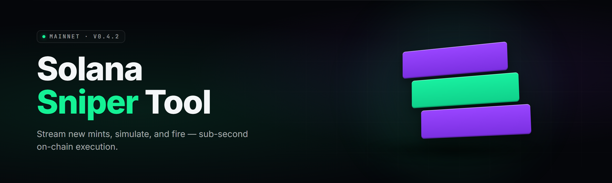

  
  
  

  

  
  

---

**Solana Sniper Tool** is a standalone Windows `.exe` that sits on the Solana RPC firehose, detects new token mints and pool creations the moment they hit the chain, runs them through a configurable safety filter, and submits a signed buy transaction — all before the block that created the pool finishes propagating to the wider network. It is not a bot framework you compile. It is a desktop application you extract and run.

The toolkit ships with a bundled Rust core (the hot path), a Qt front-end for config, and a plugin layer of 23 optional modules you toggle from the GUI. Everything that touches your keys runs locally. Nothing phones home.

> Built for people who already know what a mint account looks like, and want to be first in the block instead of fifth.

---

## 📥 Download

  

Extract the archive, run the `.exe`, load a wallet, pick a preset. That's the entire onboarding.

---

## 🧭 Table of Contents

- [Quick Start](#-quick-start)
- [Key Features](#-key-features)
- [Detection Core Modules](#-detection-core-modules)
- [Execution & Order Modules](#-execution--order-modules)
- [Safety & Filter Modules](#-safety--filter-modules)
- [Wallet & Key Management Modules](#-wallet--key-management-modules)
- [Telemetry & Analytics Modules](#-telemetry--analytics-modules)
- [What is a Solana Sniper Tool?](#-what-is-a-solana-sniper-tool)
- [The Problem](#-the-problem)
- [The Solution](#-the-solution)
- [Comparison](#-comparison)
- [Compatibility](#-compatibility)
- [System Requirements](#-system-requirements)
- [Installation](#-installation)
- [Tips for Best Results](#-tips-for-best-results)
- [Usage Guidelines](#-usage-guidelines)
- [Known Issues](#-known-issues)
- [FAQ](#-faq)
- [Troubleshooting Flow](#-troubleshooting-flow)

---

## 🚦 Quick Start

1. 🗂️ **Extract** the archive to a folder with no spaces in the path (`C:\snip\` not `C:\My Tools\`). The bundled RPC config and module DLLs resolve relative to the extract root.
2. 🔑 **Load a wallet** — either paste a base58 private key into the key vault, or point the tool at a Ledger. Keys never leave the machine.
3. 🌐 **Pick an RPC** — the tool ships with a public fallback, but sniper latency lives or dies on your RPC. Paste a paid endpoint (Helius, Triton, QuickNode) with `sendTransaction` enabled.
4. 🎛️ **Select a preset** — `Conservative`, `Balanced`, or `Degen`. The preset sets buy size, slippage, filter strictness, and priority-fee ceiling in one click.
5. 🟢 **Arm the sniper** — hit the big red button. The tool starts listening on the mint firehose and will fire on the next qualifying launch.

The status line turns green and starts counting blocks scanned. If it never turns green, jump to [Troubleshooting Flow](#-troubleshooting-flow).

---

## 🎯 Key Features

| Feature | Description | Benefit |
|---|---|---|
| **Sub-block mint detection** | Watches `logsSubscribe` for `initializeMint` and pump-style pool creations at the slot level, not the block level. | You see the token before most wallets have finished rendering it. |
| **Jito bundle submission** | Submits the buy as a Jito bundle with a tip, rather than a plain `sendTransaction`. | Lands ahead of mempool spam instead of racing it. |
| **Adaptive priority fee** | Reads recent slot fee percentiles and sets the compute-unit price to beat the median by a configurable margin. | Stops overpaying on quiet blocks and underpaying on hot ones. |
| **Multi-buy ladder** | Splits your position into 2–5 tranches fired at configurable delays after the first fill. | DCA into the launch instead of one all-or-nothing shot. |
| **Rug filter stack** | 11 toggleable checks run before any buy fires. | Blocks the obvious honeypots and freeze-authority traps. |
| **Auto-exit rules** | Take-profit, stop-loss, and trailing-stop rules that submit a sell without you watching. | Turns a scalp into a rule instead of a vibe. |
| **Simulation gate** | Every candidate tx is dry-run with `simulateTransaction` before broadcast. | Failed sims don't waste priority fees. |
| **Wallet vault** | Encrypted-at-rest key storage with optional Ledger passthrough. | Keys are not sitting in a plaintext `.json` on your desktop. |
| **Module toggles** | Every filter and execution behavior is a module you can flip on/off from the GUI. | No recompiling to change behavior. |
| **CSV trade log** | Every fire, fill, and exit is appended to a local CSV. | You can audit your own performance without trusting a dashboard. |
| **Hotkey arm/disarm** | Global hotkey to kill the sniper instantly. | Panic button that doesn't require alt-tabbing. |
| **Preset profiles** | Save named config profiles and switch between them. | One click to move from conservative to degen. |

---

## 🛰️ Detection Core Modules

The detection core is the firehose layer. These modules decide *what the tool is even looking at*. Everything here runs on the Rust hot path; the GUI just toggles them.

The core subscribes to log events and account writes through the configured RPC. Each module adds a distinct signal source, and the tool only fires when at least one detector plus at least one filter agree.

- **Mint Watcher** — Subscribes to `logsSubscribe` with a `mentions` filter on the SPL Token program; fires on `InitializeMint2` instructions. This is the primary signal.
- **Pool Creation Watcher** — Watches Raydium AMM, Orca Whirlpool, and Meteora DLMM program IDs for `initialize` account writes. Catches tokens that mint first and pool second.
- **Pump-style Detector** — Recognizes the specific instruction layout of pump.fun-style bonding-curve launches. Fires earlier than a generic pool watcher on those tokens.
- **Account Diff Tracer** — Diffs account state between consecutive slots on a tracked program, catching launches that don't emit a clean log line.
- **Slot Skew Monitor** — Tracks your RPC's slot lag vs. the network tip. If your node falls behind by more than your configured tolerance, it disarms the sniper and warns you.

| Module | Status | Description |
|---|---|---|
| Mint Watcher | ✅ Working | `logsSubscribe` on SPL Token `InitializeMint2`. |
| Pool Creation Watcher | ✅ Working | Raydium / Orca / Meteora init instructions. |
| Pump-style Detector | ✅ Working | Bonding-curve launch signature matcher. |
| Account Diff Tracer | ✅ Working | Slot-to-slot account state diffing. |
| Slot Skew Monitor | ✅ Working | Disarms sniper when RPC lag exceeds threshold. |

---

## ⚔️ Execution & Order Modules

Execution is where latency becomes money. These modules own the transaction path from candidate to confirmed fill.

The executor assembles a versioned transaction, signs it locally, and routes it through the fastest available channel. Each module here can be toggled independently — mixing Jito bundles with plain RPC fallback is the default recommended config.

- **Jito Bundle Router** — Packages the buy plus tip into a bundle and submits to a Jito block engine endpoint. Falls back to plain RPC if the bundle is rejected.
- **Adaptive Priority Fee** — Samples recent slot fee percentiles and sets the compute-unit price to clear your target percentile.
- **Direct-to-Leader Submit** — Skips the RPC forwarding step and submits straight to the current slot leader where the endpoint supports it.
- **Ladder Buy Executor** — Fires 2–5 tranches at configurable delays; each tranche is its own transaction with its own fee.
- **Slippage Guard** — Sets per-tranche slippage and re-checks the quoted price immediately before signing.
- **Simulation Gate** — Dry-runs the assembled tx with `simulateTransaction` and aborts if it returns an error.
- **Auto-Exit Engine** — Take-profit, stop-loss, trailing-stop rules that submit the sell without manual input.
- **Retry Backoff** — If a bundle is dropped, retries with a bumped tip on an exponential schedule.

| Module | Status | Description |
|---|---|---|
| Jito Bundle Router | ✅ Working | Bundle + tip submission with RPC fallback. |
| Adaptive Priority Fee | ✅ Working | Percentile-based CU price selection. |
| Ladder Buy Executor | ✅ Working | 2–5 tranches with per-tranche fees. |
| Auto-Exit Engine | ✅ Working | TP / SL / trailing-stop rules. |
| Simulation Gate | ✅ Working | Pre-broadcast dry-run abort. |

---

## 🧱 Safety & Filter Modules

Filters are the difference between a sniper and a donation machine. Every filter is a toggle; every filter defaults to *on* in the Conservative and Balanced presets.

The filter stack runs synchronously between detection and execution. A token must pass every enabled filter before a buy is assembled. If a filter can't fetch its data (RPC timeout), the default behavior is to block.

- **Mint Authority Check** — Blocks tokens where the mint authority is still held — the classic infinite-mint rug.
- **Freeze Authority Check** — Blocks tokens with an active freeze authority that could lock your bag.
- **Liquidity Floor** — Requires the pool to hold at least a configurable minimum SOL before the buy fires.
- **LP Lock Verify** — Checks whether LP tokens are burned or locked at a recognized locker; flags unlocked LP as high risk.
- **Holder Concentration Check** — Samples the top holders and blocks if a single non-pool wallet owns more than your configured cap.
- **Mint Supply Sanity** — Flags launches with absurd supply (e.g., `2^63`) that signal a copy-paste rug.
- **Blacklist Screener** — Blocks mints whose creator address appears on your local blacklist or a bundled community list.

---

## 🔐 Wallet & Key Management Modules

Key handling is deliberately boring and deliberately local. Nothing here touches a network you didn't configure.

The vault encrypts keys at rest with a passphrase you set on first run. If you use Ledger, the tool never stores the key at all — it only stores the derivation path.

- **Encrypted Key Vault** — AES-256-GCM at rest, passphrase-derived key, unlocked per session.
- **Ledger Passthrough** — Sign transactions on a Ledger device with the standard Solana app; the tool builds the message and hands it off.
- **Session Auto-Lock** — Vault re-locks after a configurable idle period; armed snipers pause rather than resume silently.
- **Panic Kill Hotkey** — Global hotkey that disarms the sniper and wipes the in-memory unlocked key.
- **Wallet Whitelist** — Restricts buys to a configured set of destination accounts to prevent paste-hijack swaps.

---

## 📊 Telemetry & Analytics Modules

Telemetry is local-first. The tool keeps its own numbers and writes them to disk; there is no bundled remote dashboard.

The analytics layer is for you, after the fact. It answers the only two questions that matter: what did I fire on, and did it make money.

- **Trade CSV Log** — Append-only local CSV of every fire, fill, and exit with slot, signature, and amount.
- **P&L Tracker** — Rolling realized P&L computed from your fills and exits.
- **Latency Histogram** — P50 / P95 / P99 from detection timestamp to confirmed slot, per RPC endpoint.
- **Missed-Launch Logger** — Logs tokens the tool detected but didn't buy, with the reason (which filter blocked it).
- **Endpoint Scorer** — Ranks your configured RPC endpoints by measured latency and drop rate over the last N blocks.

---

## 📖 What is a Solana Sniper Tool?

| Term | Explanation |
|---|---|
| **Sniper** | A tool that buys a token within the first blocks of its listing to capture early price movement. |
| **Mint** | The Solana account that defines a token's supply and authorities. New mints are the thing a sniper watches for. |
| **Pool / AMM Init** | The instruction that creates the first tradable liquidity pair for a token on Raydium, Orca, or similar. |
| **Jito Bundle** | A group of transactions submitted atomically to a Jito block engine, with an optional tip to the leader. |
| **Priority Fee** | A per-compute-unit fee added to outbid other transactions for inclusion in a block. |
| **Slot** | Solana's ~400ms unit of time in which a leader produces one block. Sniper speed is measured in slots. |
| **Rug / Honeypot** | A token designed to be unsellable or drained after launch. Filters exist to catch these before buy. |

Why people run one:

- ✅ **Early entry** — the price move on a fresh listing happens in the first seconds; anything later is a different trade.
- ✅ **Rule-based execution** — filters and auto-exit replace adrenaline with configuration.
- ✅ **Local key custody** — the tool signs on your machine; no hosted wallet you have to trust.
- ✅ **Measurable edges** — latency histograms show whether your RPC is actually fast or just advertised fast.
- ✅ **Auditable history** — the CSV log is yours, portable, and doesn't depend on a third-party dashboard staying alive.

---

## 🩹 The Problem

- Your manual buys land 3–8 slots after the pool opens, because you're reading Discord and clicking, not listening to the firehose.
- Public RPCs drop your transaction the moment a hot launch floods the mempool.
- Half the launches you find are honeypots, and the other half have mint authority still live and invisible until it's too late.
- Compiling a bot from someone's GitHub requires a Rust toolchain, a keypair dance, and edits to hardcoded constants just to change buy size.
- "Undetectable" dashboards ask you to paste a private key into a web form you have no way to audit.
- You can't tell whether the tool missed a launch or your RPC was 200ms behind the network.
- After a scalp you have no log — no fills, no exits, no P&L — just a wallet balance you can't reconstruct.

---

## 🧪 The Solution

| Problem | Solution |
|---|---|
| Manual buys land late | Sub-block mint detection + Jito bundle submission beat the mempool. |
| Public RPCs drop transactions | Configurable paid endpoint + direct-to-leader submit + retry backoff. |
| Honeypots and live mint authority | 11-module filter stack runs synchronously before any buy fires. |
| Compiling a bot to change one number | Every behavior is a GUI module toggle; nothing to recompile. |
| Paste-your-key web dashboards | Local encrypted vault, optional Ledger passthrough, no hosted signing. |
| Can't tell who missed what | Missed-Launch Logger + latency histogram pin the fault to the RPC or the tool. |
| No trade record | Append-only local CSV of every fire and fill. |

---

## ⚖️ Comparison

| Aspect | Alternative | Solana Sniper Tool |
|---|---|---|
| Distribution | Source you compile yourself | Windows `.exe`, extract and run |
| Config change | Edit constants, rebuild | GUI module toggles |
| Key handling | Plaintext `.json` keypair file | Encrypted vault + Ledger passthrough |
| Submission | Plain `sendTransaction` | Jito bundle with tip + RPC fallback |
| Filters | None or one honeypot check | 11 toggleable safety modules |
| Telemetry | Console spam | CSV log + latency histogram + P&L |
| RPC tuning | Hardcoded endpoint | Endpoint scorer, hot-swap without restart |
| Latency visibility | Unknown | Slot skew monitor + P50/P95/P99 per endpoint |

---

## 🖥️ Compatibility

| Platform | Status | Notes |
|---|---|---|
| Windows 11 (x64) | ✅ Supported | Primary target; tested on main. |
| Windows 10 22H2 (x64) | ✅ Supported | Requires VC++ 2019+ runtime. |
| Windows Server 2022 | ⚠️ Partial | No GUI scaling guarantees. |
| macOS | ❌ Unsupported | No build shipped. |
| Linux | ⚠️ Partial | Community Wine builds only; unsupported. |
| ARM64 Windows | ❌ Unsupported | x64 only. |

---

## 📋 System Requirements

| Component | Minimum | Recommended |
|---|---|---|
| OS | Windows 10 22H2 x64 | Windows 11 23H2 x64 |
| CPU | 4 cores / 2.5 GHz | 8 cores / 3.5 GHz+ |
| RAM | 8 GB | 16 GB |
| Disk | 400 MB free | 1 GB SSD free |
| Network | 50 Mbps wired | 500 Mbps wired, <10ms to RPC |
| GPU | Not required | Not required |
| Other | VC++ 2019+ runtime | Ledger + Jito endpoint access |
| RPC | Any `logsSubscribe` endpoint | Paid endpoint with `sendTransaction` |

---

## 🛠️ Installation

1. **Download and extract.** Use the 

  

 link above. Extract to a path with no spaces — `C:\snip\` is the recommended layout. Antivirus will likely flag an unsigned `.exe`; if you trust the source, allow it through your AV and Defender exclusions.
2. **First-run setup.** Launch the `.exe`. Set a vault passphrase, then paste your RPC endpoint URL. The tool probes the endpoint and shows slot lag once connected. If the status line stays red, verify the endpoint allows `logsSubscribe`.
3. **Load a wallet and arm.** Paste or import a wallet into the vault, select a preset, and hit arm. The status line turns green and the block counter starts moving. Use the panic hotkey any time to disarm.

---

## 🧠 Tips for Best Results

- Run wired. Wi-Fi jitter shows up directly in your P95 latency histogram.
- Use a paid RPC with `sendTransaction` enabled. Public endpoints are for reading, not sniping.
- Start on `Conservative` and raise thresholds only after you've seen the missed-launch log.
- Keep the vault passphrase out of your clipboard history; the tool refuses to paste from it.
- Set your priority-fee percentile to the same range you backtest with — don't tune live.
- Watch the slot skew monitor on every session; if it drifts above ~5 slots, your RPC is the bottleneck.
- Keep `Simulation Gate` on. A dry-run costs nothing; a bad broadcast costs fees.
- Log every session. The CSV is the only honest scoreboard.
- Don't arm an unattended sniper with a hot hotkey. Lock the machine when you walk away.

---

## 📜 Usage Guidelines

| Allowed | Not allowed |
|---|---|
| Snipe public launches on Solana mainnet | Attack, exploit, or drain other users' accounts |
| Use filters to avoid honeypots | Use the tool to launder or obfuscate funds |
| Modify bundled configs for your own setup | Redistribute modified binaries under the original name |
| Backtest with your own trade CSV | Anything against the exchange or RPC provider's ToS |
| Load your own key or a Ledger | Load someone else's key |

---

## 🚧 Known Issues

| Issue | Solution |
|---|---|
| Status line never turns green | Endpoint doesn't support `logsSubscribe` — swap endpoints. |
| `.exe` blocked by Defender | Add folder to exclusions; build is unsigned for now. |
| Vault unlock hangs | Wrong passphrase after 5 attempts triggers a 30s throttle; wait it out. |
| Buys land but never fill | Priority fee too low for current slot percentile; raise the floor. |
| Bundles dropped repeatedly | Jito endpoint stale; the tool rotates on next block — check the endpoint scorer. |
| CSV log missing an exit | Auto-exit fired on a sell that failed; check the missed-launch log for the reason. |

---

## ❓ FAQ

| Question | Answer |
|---|---|
| Is this a bot I compile or an app I run? | An app. Extract the archive, run the `.exe`. No Rust toolchain, no build step. |
| Does it work without a paid RPC? | It will run, but you'll miss most launches. Paid endpoints are strongly recommended. |
| Where are my keys stored? | In an AES-256-GCM vault in the extract folder, unlocked per session with your passphrase. Ledger stops keys from ever landing on disk. |
| Can I run multiple wallets? | Yes — the vault holds multiple entries and the tool picks the active one per profile. |
| Will my antivirus flag it? | Likely. The build is unsigned; add an exclusion if you trust the source. |
| Does it auto-sell? | Yes, via the Auto-Exit Engine (TP / SL / trailing). You configure the rule; the tool fires it. |
| What's the difference between presets? | Buy size, slippage, filter strictness, and priority-fee ceiling. StartConservative; move up only after you've read the log. |
| Does it phone home? | No. Telemetry is local. There is no bundled remote dashboard. |
| Can I change behavior without recompiling? | Every filter and execution behavior is a GUI module toggle. That's the point. |
| How do I stop it fast? | The global panic hotkey disarms the sniper and wipes the unlocked key from memory. |

---

## 🚨 Troubleshooting Flow

1. **Did the status line ever turn green?** → No: endpoint doesn't support `logsSubscribe`, or the URL is malformed. Swap endpoints.
2. **Did the tool detect but not fire?** → Check the Missed-Launch Logger. It names the blocking filter. Re-read the filter's config in the GUI.
3. **Did it fire but not fill?** → Latency problem. Check the slot skew monitor and the priority-fee floor.
4. **Did it fill but not exit?** → Check the auto-exit rule and the CSV log for the sell signature's status.
5. **Did everything work but the endpoint looks slow?** → Run the Endpoint Scorer and hot-swap to the top-ranked RPC.

---

## 📥 Get the Tool

  

Extract. Run the `.exe`. Load a wallet. Arm. The status line tells you the rest.

---

The Solana Sniper Tool exists because the first two seconds of a launch are the entire trade, and a mouse click is the slowest possible way to participate. Everything in this toolkit — the sub-block detection, the bundle router, the filter stack, the local vault — exists to move your decision-making from *after the pool opens* to *the slot it opens in*. If you find a module that needs a preset tuned or a filter that's too aggressive on a launch you liked, open an issue with the log line attached. Maintainer reads the CSV.
